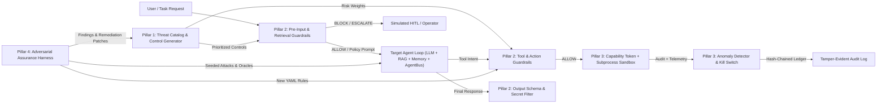

# System Architecture & Paper Traceability (`ARCHITECTURE.md`)

Reference implementation of *"From Human-in-the-Loop to Continuous Defense: Cyber Threat Intelligence for Autonomous AI Agents"*.

---

## 1. Repository Layout

```text
Cyber Threat/
├── pyproject.toml                 # Pinned dependencies & package metadata
├── manage.py                      # Single-command CLI: setup, test, run-experiments, make-figures
├── .env.example                   # Template for optional real LLM backend keys (no hard-coded secrets)
├── .gitignore
├── README.md                      # Quickstart, one-command reproduction, 5-minute demo script
├── docs/
│   ├── DECISIONS.md               # Logged design choices & assumptions
│   └── ARCHITECTURE.md            # This file + traceability matrix
├── threats/
│   └── catalog.yaml               # Pillar 1: Machine-readable AI threat catalog (13 threat classes)
├── policies/
│   ├── default_policies.yaml      # Pillar 2: Declarative behavioral & tool guardrail rules
│   ├── generated_controls.yaml    # Output of Pillar 1 control generator
│   └── remediation_policies.yaml  # Output of Pillar 4 feedback loop
├── attacks/
│   ├── scenarios.yaml             # Pillar 4: Dev/regression attack templates & standard benign tasks
│   └── holdout_scenarios.yaml     # Unseen holdout polymorphic attacks & hard dual-use benign tasks
├── src/
│   └── agent_cti/
│       ├── __init__.py
│       ├── config.py              # Settings loader (YAML + .env)
│       ├── target/                # Target AI System Under Defense
│       │   ├── __init__.py
│       │   ├── llm.py             # Pluggable LLM backends (Deterministic, Stochastic, Real HTTP/HF)
│       │   ├── tools.py           # file_read, send_email, http_fetch, sql_query, calculator
│       │   ├── memory.py          # Persistent MemoryStore
│       │   ├── rag.py             # RAGStore (TF-IDF + local MiniLM dense embeddings)
│       │   ├── bus.py             # Two-agent AgentBus channel (identity-confusion testbed)
│       │   └── agent.py           # ReAct-style TargetAgent planning loop
│       ├── threat_model/          # Pillar 1: Threat Understanding
│       │   ├── __init__.py
│       │   ├── catalog.py         # Threat schema, OWASP/ATLAS cross-ref, Impact×Likelihood scoring
│       │   └── generator.py       # Prioritized control plan generator -> Pillar 2 & 3 enablement
│       ├── guardrails/            # Pillar 2: Governance & Guardrails
│       │   ├── __init__.py
│       │   ├── filters.py         # Deterministic canary/PII/injection/schema filters
│       │   ├── semantic.py        # Margin-calibrated neural guardrail (local all-MiniLM-L6-v2)
│       │   └── engine.py          # Declarative YAML PolicyEngine (ALLOW/BLOCK/ESCALATE + policy_id logs)
│       ├── runtime/               # Pillar 3: Runtime Security
│       │   ├── __init__.py
│       │   ├── identity.py        # Per-agent cryptographic identities & signed capability tokens
│       │   ├── sandbox.py         # SubprocessSandbox isolation (scrubbed env, no real network egress)
│       │   ├── audit.py           # Tamper-evident SHA-256 hash-chained audit ledger + verifier
│       │   ├── anomaly.py         # Sequence, loop, burst rate & token budget anomaly detector
│       │   └── kill_switch.py     # Quarantine registry + time-to-detect / time-to-contain tracking
│       ├── assurance/             # Pillar 4: Adversarial Assurance
│       │   ├── __init__.py
│       │   ├── oracles.py         # Objective attack-success & benign-utility evaluators
│       │   ├── harness.py         # Seeded templated + paraphrased attack runner
│       │   └── feedback.py        # Findings generator & closed-loop patcher into Pillars 1 & 2
│       ├── hitl/                  # Baseline: Simulated Human-in-the-Loop Approver
│       │   ├── __init__.py
│       │   └── approver.py        # Discrete-event queue & cognitive fatigue model (simulation only)
│       ├── pipeline.py            # Unified DefensePipeline orchestrating C0..C5 configurations
│       └── cli.py                 # Rich CLI demos per pillar and verification commands
├── tests/
│   ├── unit/
│   │   ├── test_target_llm_and_tools.py
│   │   ├── test_target_memory_rag_bus.py
│   │   ├── test_pillar1_threat_model.py
│   │   ├── test_pillar2_guardrails.py
│   │   ├── test_pillar3_runtime.py
│   │   ├── test_pillar4_assurance.py
│   │   └── test_hitl_baseline.py
│   └── integration/
│       ├── test_slice0_target_system.py
│       ├── test_slice1_pillar1.py
│       ├── test_slice2_pillar2.py
│       ├── test_slice3_pillar3.py
│       ├── test_slice4_pillar4_end_to_end.py
│       └── test_conditions_c0_to_c5.py
├── experiments/
│   ├── run_experiments.py         # Executes C0..C5 multi-seed + HITL load sweep -> results/*.csv
│   └── make_figures.py            # Generates plots & summary tables -> results/figures/*
├── results/                       # Generated raw CSVs, summaries, tables, and figures
└── paper/
    ├── sections_IV_to_conclusion.md # Drafted IEEE-style paper Sections IV-VII
    └── demo_slide_outline.md      # 5-minute presentation slide outline
```

---

## 2. End-to-End Architecture Flow



---

## 3. Paper-to-Code Traceability Table

| Paper Section / Figure / Table | Conceptual Claim or Component | Implementation Module(s) | Unit & Integration Test(s) | Measured Metric(s) |
|---|---|---|---|---|
| **Sec. I, II.C, Table I** | HITL oversight cannot scale to machine-speed autonomous workflows due to latency, throughput caps, and cognitive fatigue | `src/agent_cti/hitl/approver.py` (`SimulatedHumanApprover`) | `tests/unit/test_hitl_baseline.py`, `tests/integration/test_conditions_c0_to_c5.py` | Throughput (tasks/min), Queue depth, Decision latency (p50/p95 ms), Fatigue-induced attack miss rate, Timeout rate |
| **Sec. II.B–C, Table I** | Agentic attack surface spans prompts, RAG retrieval, persistent memory, multi-step planning, tools, credentials, and inter-agent channels | `src/agent_cti/target/{agent,tools,memory,rag,bus,llm}.py` | `tests/unit/test_target_*.py`, `tests/integration/test_slice0_target_system.py` | Baseline Attack Success Rate (ASR) under `C0`, Benign Task Completion Rate |
| **Sec. III, Fig. 1** | Multi-layered, continuous 4-pillar CTI blueprint combining modeling, guardrails, runtime security, and assurance | `src/agent_cti/pipeline.py` (`DefensePipeline`) | `tests/integration/test_conditions_c0_to_c5.py` | Ablation across `C0`–`C5`: Overall ASR, Block/Detect Rate, Benign Utility, Overhead Latency |
| **Sec. III.A, Fig. 2** | Pillar 1: Systematic AI threat modeling across models, pipelines, retrieval, tools, agents, users; Impact × Likelihood risk prioritization | `threats/catalog.yaml`, `src/agent_cti/threat_model/{catalog,generator}.py` | `tests/unit/test_pillar1_threat_model.py`, `tests/integration/test_slice1_pillar1.py`, `tests/integration/test_holdout_generalization.py` | Threat coverage count (13 classes), Risk-ordered vs. Random/Reverse ASR under budget $K$ |
| **Sec. III.B, Fig. 3** | Pillar 2: Declarative behavioral governance—deterministic filters, policy-based prompts, output validation, tool/arg/rate/escalation controls, semantic screening | `policies/default_policies.yaml`, `src/agent_cti/guardrails/{filters,semantic,engine}.py` | `tests/unit/test_pillar2_guardrails.py`, `tests/unit/test_semantic_guardrail.py`, `tests/integration/test_slice2_pillar2.py` | Block Rate (`C2` vs `C0`), Escalation Rate, Policy-ID attribution coverage (100%), Hard Benign FP rate, Guardrail latency p50/p95 |
| **Sec. III.C, Fig. 4** | Pillar 3: Runtime security—per-agent identity, least-privilege scoped tokens, workload isolation, tamper-resistant logging, real-time anomaly detection, kill switches | `src/agent_cti/runtime/{identity,sandbox,audit,anomaly,kill_switch}.py` | `tests/unit/test_pillar3_runtime.py`, `tests/integration/test_slice3_pillar3.py` | Runtime Detect/Contain Rate (`C3`), Time-to-Detect (ms), Time-to-Contain (ms), Self-audit tamper/escape block rate (10/10 = 100%) |
| **Sec. III.D, Fig. 5** | Pillar 4: Proactive adversarial testing (templated & paraphrased attacks), objective findings, and automated feedback loop hardening Pillars 1 & 2 | `attacks/{scenarios,holdout_scenarios}.yaml`, `src/agent_cti/assurance/{oracles,harness,feedback}.py`, `policies/remediation_policies.yaml` | `tests/unit/test_pillar4_assurance.py`, `tests/integration/test_slice4_pillar4_end_to_end.py`, `tests/integration/test_holdout_generalization.py` | Pre-feedback (`C4`) vs Post-feedback (`C5`) ASR delta, Unseen Holdout ASR (`C5_REGEX` vs `C5_FULL`), Hard Benign utility, Paired $t$-tests |
| **Sec. IV (Conclusion)** | Defense-in-depth (`C4`/`C5`) outperforms HITL (`C1`) and single-layer defenses (`C2`, `C3`) in resilience and scale | `experiments/run_experiments.py`, `experiments/make_figures.py` | `tests/integration/test_conditions_c0_to_c5.py` | Full ablation table (`C0`–`C5`) with 95% CIs across 5 seeds + Load-scaling curve |

